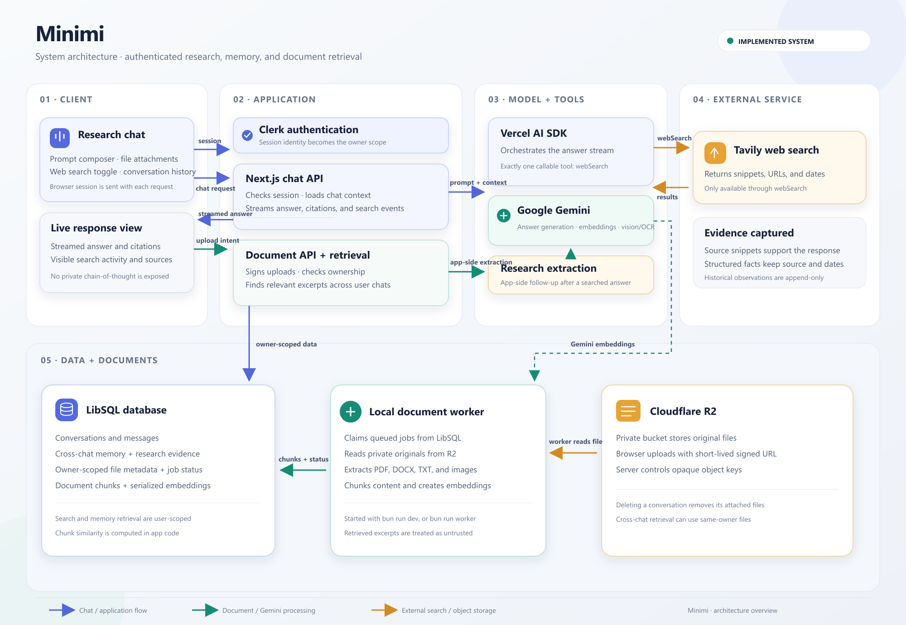

# Minimi — Design and Architecture

## 1. Purpose

Minimi is a persistent, time-aware AI research assistant. It is designed to answer new questions, recall relevant research from earlier conversations, verify whether historical findings remain accurate, and answer questions about user-uploaded documents.

The central design principle is that **memory is evidence for a new answer, not a transcript to replay**. Historical observations are kept separate from current web evidence so the system can distinguish what it previously found from what it can verify now.

## 2. System architecture

A scalable [SVG version](./docs/minimi-architecture.svg) and the [diagram notes](./docs/architecture.md) are also available.

### Request and research flow

1. **Client:** The Next.js chat interface sends the message, conversation ID, browser time zone, and web-search preference to the chat API. It displays streamed answer text, citations, and search activity.
2. **Authentication and ownership:** Clerk authenticates the request. The server uses the Clerk user ID as the owner scope for conversation, memory, research, and document queries.
3. **Context retrieval:** The API loads recent conversation history and, when relevant, retrieves matching cross-conversation turns and structured research observations for the same user. Document retrieval supplies a bounded set of relevant excerpts from that user's completed uploads.
4. **Agent orchestration:** The Vercel AI SDK streams Gemini responses. The model has exactly one callable tool, `webSearch`, backed by Tavily. Direct historical recall can be answered from retrieved history without web search; change-detection requests use the historical baseline and fresh search results when search is enabled.
5. **Evidence capture:** Search hits remain available to application code with their URLs and dates. A separate application-side extraction call proposes structured observations; validation checks that each observation points to a returned URL and is supported by the supplied excerpt. New observations are appended rather than replacing earlier ones.
6. **Document ingestion:** The browser uploads originals directly to a private Cloudflare R2 bucket using short-lived signed URLs. A local background worker claims queued jobs, reads the private object, extracts content, chunks it, generates Gemini embeddings, and writes chunks and processing metadata to LibSQL.

## 3. Components and responsibilities

| Component | Responsibility |
| --- | --- |
| Next.js App Router | Chat UI, authenticated API routes, streaming, upload intents and downloads |
| Clerk | User authentication and server-side owner identity |
| Vercel AI SDK | Model orchestration, streaming, and the single callable tool |
| Google Gemini | Answer generation, structured research extraction, embeddings, and image/OCR processing |
| Tavily | External web search through `webSearch` |
| LibSQL | Conversations, messages, user-scoped memory, research sessions, observations, document metadata, jobs, chunks, and embedding JSON |
| Cloudflare R2 | Private storage for original uploaded files |
| Document worker | Asynchronous extraction, chunking, embedding, retry, and indexing |

## 4. Key design decisions

### One model-callable tool

Only `webSearch` is exposed to the model. Historical memory and document retrieval are performed by authenticated application code before model generation. This keeps database access and ownership checks outside the model's tool surface and makes retrieval bounded and testable.

### Historical memory is not current truth

Research sessions retain the question, summary, sources, and observation time. Observations preserve entity, attribute, value, source URL, and relevant dates; price observations can also store plan, currency, billing interval, price basis, and region. Historical-versus-current comparisons require comparable evidence. The result is `Changed`, `Unchanged`, or `Unable to verify`; absence of a search result is not proof that nothing changed.

### Relational persistence before specialized infrastructure

LibSQL stores application state and serialized embeddings. Document similarity is computed in application code using cosine similarity and lexical overlap over a bounded candidate set. This avoids adding a separate vector database or queue service before scale requires one. Schema setup is additive and idempotent through `ensureSchema()`; it is not a versioned migration framework.

### Private object storage and asynchronous processing

Original files are stored in a private R2 bucket, not in database rows or public URLs. The server creates opaque object keys and short-lived presigned URLs. The worker processes queued jobs independently of the chat request, retries failed jobs up to three attempts, and records visible status. The current upload limit is 25 MiB; supported formats are PDF, DOCX, TXT, PNG, JPEG, and WebP.

### Retrieval is owner-scoped and bounded

Conversation, memory, research-session, document, and chunk retrieval is filtered by the authenticated user. Relevant excerpts are bounded before they enter the model context. Document text and retrieved web content are treated as untrusted evidence, never as instructions.

## 5. Data model

- `conversations` and `messages`: chat ownership and conversation turns.
- `memory_items`: durable, user-scoped cross-conversation summaries.
- `research_sessions`: saved research question, answer summary, owner, and research time.
- `entities`, `sources`, and `observations`: normalized research entities, source metadata, and append-only historical facts. Observations are reached through owner-scoped research sessions.
- `documents`: owner/conversation-scoped metadata, opaque R2 object key, status, retry count, and parser/embedding versions.
- `document_chunks`: owner-scoped extracted content, page/section metadata, content hash, and serialized embedding.

## 6. Local setup

The complete setup guide and environment-variable reference are in [README.md](./README.md). The short version:

1. Install Bun and clone the repository.
2. Run `bun install`.
3. Copy `.env.example` to `.env.local`.
4. Configure Google AI, Tavily, and Clerk keys. Configure private Cloudflare R2 credentials to enable document uploads.
5. Run `bun run dev` and open [http://localhost:3000](http://localhost:3000).

`bun run dev` starts Next.js and the local document worker. Alternatively, `bun run dev:web` starts only the web application and `bun run worker` starts the worker in a separate terminal. The default database is `file:./data/minimi.db`; the schema is initialized additively on first use.

## 7. Known limitations and trade-offs

- Memory and research matching use bounded lexical, entity, and date matching rather than embedding-based semantic memory; paraphrased or ambiguous references can be missed.
- Document retrieval scans at most 1,000 candidate chunks and computes similarity in application code. A dedicated vector index may be justified only if measured scale or latency requires it.
- Evidence validation can check source URL membership and excerpt support, plus selected numeric/date constraints, but cannot prove every natural-language claim or source authority.
- Price comparisons are conservative: missing or mismatched plan, currency, billing interval, price basis, or region results in `Unable to verify`.
- The local worker must be deployed as a separate long-running process in hosted environments.
- The database uses additive inline schema setup rather than a versioned migration framework. The write queue is process-local and does not coordinate multiple server processes.
- Fixture-based CRM, recall, and PostgreSQL tests verify application behavior, not live market facts. Live provider verification requires configured API credentials.
- R2 upload/download, OCR, and embedding smoke tests require a configured private bucket and provider credentials.
