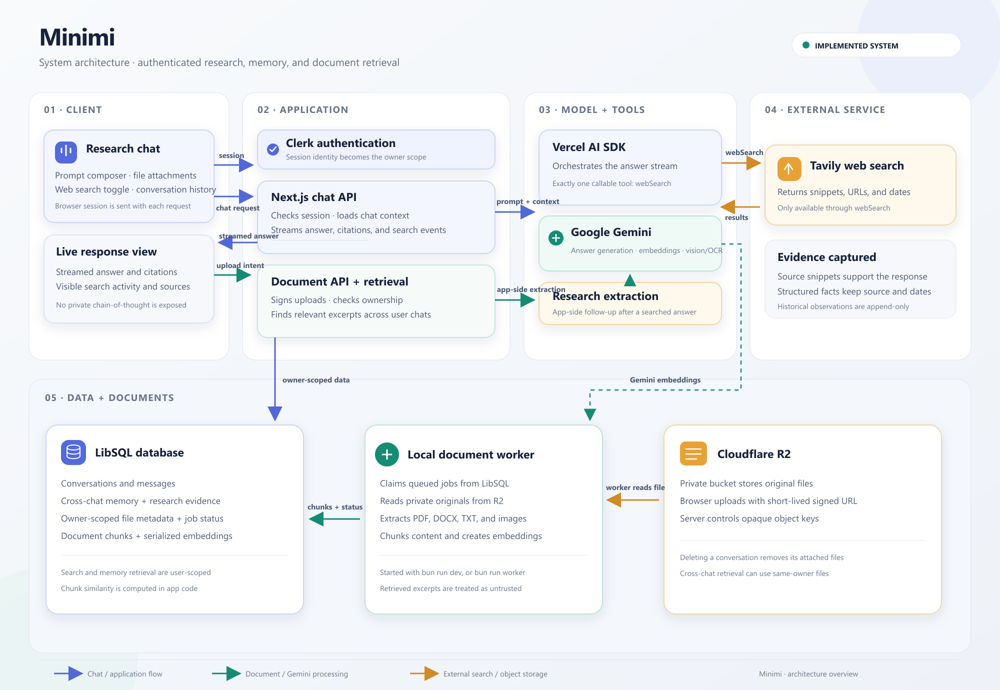

# Minimi system architecture

- [Open the PNG diagram](./minimi-architecture.png)
- [Open the scalable SVG diagram](./minimi-architecture.svg)

The diagram shows the implemented boundaries and main data paths: Clerk-authenticated chat; the Next.js chat and document APIs; Gemini answer generation, embeddings, and image extraction; Tavily accessed only through the `webSearch` tool; owner-scoped LibSQL conversations, memory, research evidence, document metadata and chunks; and private Cloudflare R2 storage.

Original files are uploaded directly from the browser to R2 using short-lived signed URLs. The local document worker reads queued originals, extracts and chunks content, generates Gemini embeddings, and stores the resulting chunks in LibSQL. Chat retrieval can use relevant completed documents across conversations owned by the same user. Search activity and citations are visible in the UI; private model reasoning is not exposed.
